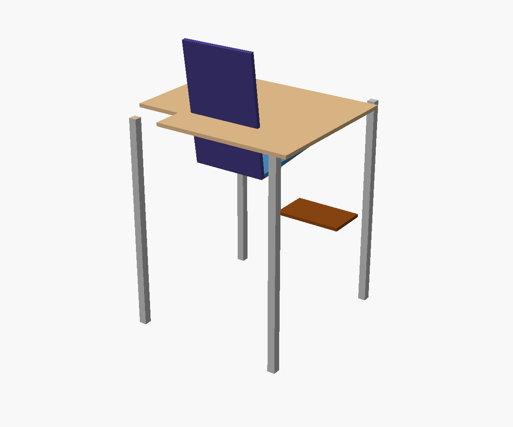

# adaptive-highchair

Parametric, printable adaptive high-chair concept. The design target is a
low-cost seating aid built from printed brackets and connectors around
off-the-shelf tube/wood stock, rather than a fully printed chair.

> **Scope / safety:** This is a research and prototyping project. It is not a
> medical device and has not been tested to any furniture or child-safety
> standard. Do not use it with a child without qualified engineering review,
> materials selection, and physical testing.

## Files

- `RESEARCH.md` — commercial product specs and extracted design inputs
- `DESIGN_NOTES.md` — requirements and planned architecture
- `params.scad` — all design dimensions (mm), edit this first
- `adaptive-highchair.scad` — concept geometry; `include`s `params.scad`
- `render.sh` — regenerates `preview.png` from the `.scad`



## Status

Research complete. Concept geometry is a dimensioned blockout only — no
harness anchors, no structural analysis, no print profiles yet.

## Quick start

```sh
openscad -o adaptive-highchair.stl adaptive-highchair.scad
```
