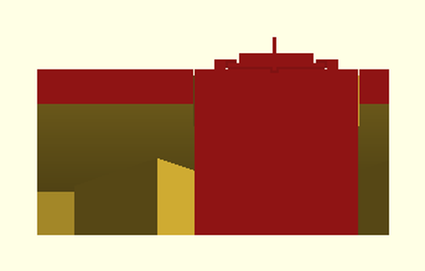
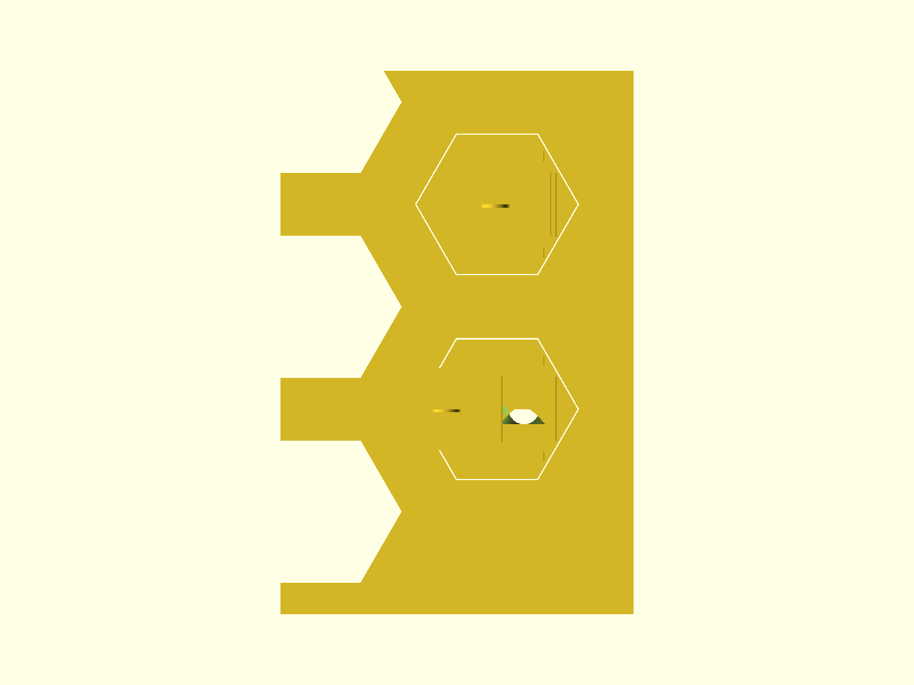
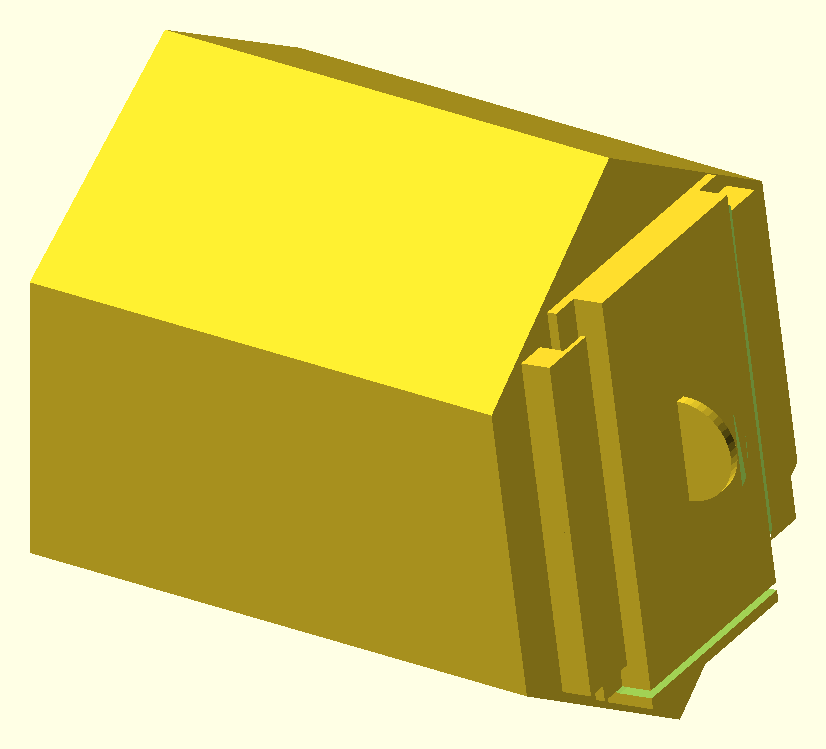

# hex-ramp-insert — screw-down anchor + registration insert

A hex plug for the **top row** of the hex ramp (the row past the vertical jump,
in the rolled transition). It drops into a 15.86 mm hole, its post reaches the
floor, and a captive slider swings out over the ramp surface to hold the ramp
down. One countersunk screw through the middle ties it to the floor.



## Install / remove

1. Ramp in place, insert dropped into a top-row hole. Slider in **rest** — the
   plate is flush with the driving surface and the screw detent is covered.
2. Slide the slider **out** (down-slope). It overlaps the ramp surface, so the
   ramp is captive, and the screw countersink is exposed.
3. Drive one countersunk screw through the plate and post into the floor.
4. Later: slide the slider back in, lift the ramp away. The screwed posts stay
   behind as registration pillars — drop the ramp back on them and repeat.

## Fit

| | |
|---|---|
| hole | 15.86 mm across flats, vertical through-bore, x = +16.19 column |
| insert | 15.56 mm across flats → **0.15 mm/side** (same as the medium clip) |
| post | 15.92 mm from the top surface to the floor at that column |
| plate | within the hex outline, 0.25 mm above the face, so the ramp lifts straight off |
| slider | 12.5 × 7.2 × 1.25 mm, T-slot under two rails, 5.5 mm travel |
| screw | M3 countersunk, Ø3.4 clearance, Ø6.0 × 1.5 countersink; ~20 mm long for a 15.92 post |
| PIP gap | 0.22 mm (the body is cut with an offset shell of the slider) |

CSG check against `ramp_half_hex.stl` at three top-row holes (z = 22.86, 114.30,
205.74): **0.0000 mm³** intersection.



## Print

STL is exported in the print orientation: hex post lying flat on the bed, the
plate/slider plane vertical. That is the only orientation where the PIP gap is
horizontal (no bridging, nothing in the bed).

| | |
|---|---|
| orientation | as exported (Z up) |
| supports | none — 0 support moves with supports enabled |
| mass / time | 3.38 g / 0.27 h on the hex-ramp P1S profile |
| mesh | watertight, 2 bodies (body + captive slider), 0 degenerate tris |

The rail and slider *end* faces are horizontal overhangs in this orientation
(≈90 mm² total); they bridge on their own. Slight sag there is cosmetic.

## Rebuild

```bash
openscad -o stl/hex_ramp_insert.stl scad/hex_ramp_insert.scad
python tools/fitcheck.py          # CSG fit against the ramp mesh
```

`-D open=1` renders the slider out (previews only). `scad/section.scad` and
`scad/closeup.scad` are view-only.



## Parameters worth changing

- `post_len` (15.92) — top surface to whatever the insert screws into.
- `screw_d` / `cs_d` — for a different screw.
- `clearance` (0.30 total) — tighten for a press fit.
- `travel` (5.5) — how far the slider overhangs the ramp.

## Provenance

Ramp measured from `hex-ramp/ramp_half_hex.stl` (57-hole revision). The insert is
original. No third-party mesh committed; preview scripts reference the ramp STL
by path.

## Safety

Small parts — keep away from children who mouth objects. Not load-bearing.
